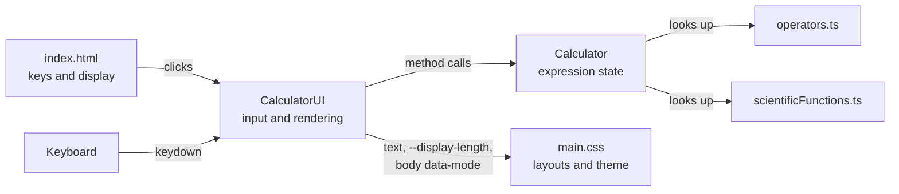
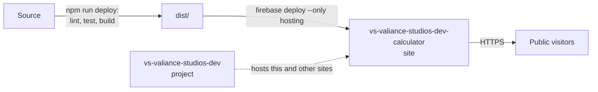

# Architecture

A static, single-page calculator built with TypeScript and Vite. It has no runtime dependencies and no backend. This document describes how the code fits together. For how to work on it, see [CLAUDE.md](CLAUDE.md).

## Overview

| File | Responsibility |
|---|---|
| `index.html` | Every key and the display. Keys declare what they do through `data-type` and `value`. |
| `src/main.ts` | Creates a `Calculator` and a `CalculatorUI`. |
| `src/calculatorUIClass.ts` | Turns clicks and key presses into `Calculator` calls, then renders the result. Owns the current view. |
| `src/calculatorClass.ts` | The engine: entry, pending operations, and evaluation. Never touches the DOM. Owns the angle unit. |
| `src/operators.ts` | Table of two-operand operators: symbol, precedence, associativity, and behaviour. |
| `src/scientificFunctions.ts` | Tables of one-operand functions and constants, plus angle conversion. |
| `src/styles/main.css` | Theme variables and every layout. |
| `lib/error.ts` | `wrapError` helper, reachable through the `@lib/*` path alias. Nothing uses it yet. |
| `public/` | Files copied to the site as they are. `favicon.svg` is the icon's source, and `favicon-32.png` and `apple-touch-icon.png` are renders of it for browsers that need PNG. iOS adds its own rounded corners, so the touch icon has square corners. |
| `tests/` | Vitest unit tests for the engine, and integration tests for the UI against a small DOM fixture (jsdom). |

## Input flow

1. A key press reaches `CalculatorUI` in one of two ways. A single delegated click listener on `.calculator-wrapper` reads the button's `data-type` and `value`. A `keydown` listener on `window` maps the key to the same pair in `mapKeyboardToInput`.
2. `handleInput` dispatches on the type, and every input ends by calling `updateDisplay`:

| `data-type` | `value` | Result |
|---|---|---|
| `number` | Digits, `00`, `.` | `Calculator.appendNumber` |
| `operator` | A key of `OPERATORS` | `Calculator.chooseOperation` |
| `function` | A key of `SCIENTIFIC_FUNCTIONS` | `Calculator.applyFunction` |
| `constant` | A key of `SCIENTIFIC_CONSTANTS` | `Calculator.enterConstant` |
| `action` | A key of `CalculatorUI.actions` | Clear, delete, compute, percent, parentheses, and the view and angle toggles |

Keyboard mapping ignores any key held with Cmd, Ctrl, or Alt, so browser shortcuts keep working. Scientific hotkeys (`SCIENTIFIC_HOTKEYS`) apply only in the scientific view, where they can't intercept ordinary typing.

## The engine

`Calculator` evaluates as keys are pressed, using a variant of the shunting-yard algorithm. It has two main pieces of state:

- `currentOperand`: the string on the primary display. `'Error'` is the error state.
- `pending`: a stack of `{operand, operation}` entries waiting for a right-hand side, plus `'('` markers. Between markers, precedence increases towards the top of the stack.

Choosing an operator resolves every pending operation that binds at least as tightly, and then pushes the new one. Right-associative operators resolve only what binds strictly tighter.

| Keys | `pending` | `currentOperand` | Why |
|---|---|---|---|
| `2 +` | `2 +` | `2` | Waiting for a right-hand side |
| `3 ×` | `2 +`, `3 ×` | `3` | `×` binds tighter than `+`, so `+` has to wait |
| `4` | `2 +`, `3 ×` | `4` | Typing only changes the entry |
| `+` | `14 +` | `14` | `+` resolves `3 × 4`, then `2 + 12` |

`reducePending` does this work and stops at any `'('`. `closeParenthesis` reduces to the nearest marker and removes it, while `compute` reduces and removes markers until the stack is empty.

### Entry flags

| Flag | Meaning |
|---|---|
| `shouldResetScreen` | The next digit starts a new number rather than appending. |
| `isOperandComputed` | The operand was produced by `%`, a function, a constant, or `)`, rather than typed. Typing replaces it, but operators still treat it as a right-hand side. |
| `isEvaluated` | A result was just produced, so the expression line is empty. |

`hasSecondOperand()` combines the first two. It decides whether a second operator in a row replaces the first, and whether the expression line shows the current operand.

### Results and errors

- Any non-finite result enters the error state, so operators and functions don't need their own checks for cases such as dividing by zero, `√-1`, or `ln 0`.
- `formatResult` rounds to 12 decimal places to hide floating-point noise. It skips rounding at `1e15` and above, where scaling could overflow, and keeps very small results that would otherwise round to 0.
- Trigonometry snaps results below `1e-12` to 0, so `sin(180°)` is exactly `0` and `tan(90°)` is an error instead of a huge number.
- Pressing `=` again repeats the last operation, using `lastOperation` and `lastOperand`.

## Views and layouts

Which layout appears depends on two independent inputs. Viewport size comes from media queries, with no device detection. The view comes from `data-mode` on `<body>`, set by `CalculatorUI`. Keys are placed by named `grid-area` values in `index.html`, so a layout only has to rearrange names.

| Viewport | Basic view | Scientific view |
|---|---|---|
| 900px or wider and over 580px tall | 500px card, 6 × 4 keys | 900px card, 5 × 4 scientific keys beside 6 × 4 basic keys |
| 541–899px wide and over 580px tall | 500px card, 6 × 4 keys | 500px card, 6 × 3 scientific keys above 6 × 4 basic keys |
| 541px or wider and 580px tall or less | Full screen, 6 × 4 keys | Full screen, 5 × 4 scientific keys beside 6 × 4 basic keys |
| 540px wide or less | Full screen, 4 × 6 keys | Full screen, 6 × 3 scientific keys above 4 × 6 basic keys |

The compact full-screen layouts share these behaviours:

- **Minimum heights:** key rows use `minmax(var(--key-min-height), 1fr)`. Below that height the page scrolls rather than squashing the keys.
- **Sticky display:** the display stays pinned while the keys scroll.
- **Sharing spare height:** in portrait, the display and keys each start at the height they need and share what's left, so the display gives up its spare height before the page scrolls.
- **Safe areas:** padding respects device notches and home bars through `env(safe-area-inset-*)`.

### Display text

`CalculatorUI` publishes each display line's character count as `--display-length`. The stylesheet uses it with container query units to shrink text that wouldn't fit on one line, so no measuring is needed. The left padding of `.calculator-display` keeps text clear of the view toggle.

### Theme

All colours and layout sizes are custom properties on `:root`, and layouts override them in media queries. `--color-key-standard-active` is lighter on touch screens, where there's no hover state to contrast a press with.

## Behaviour decisions

These are deliberate choices, not oversights:

- **Standard math order applies in both views**, so an expression gives the same answer in each.
- **`%` means percent.** After `+` or `-` it's relative to the operand before it, so `200 + 10 % =` gives `220`. After `×` or `÷` it's a plain fraction. Remainder is the separate `mod` key.
- **`mod` keeps the sign of the first operand**, like JavaScript's `%`, so `-7 mod 3` is `-1`.
- **Functions apply to the number on the display**, like `%` and `+/-`, so `9` then `√` gives `3`. The expression line shows the result, not the function.
- **A value directly before `(` multiplies the group**, so `2(3 + 4)` is `14`.
- **`DEL` only edits a typed number.** It can't remove an opened parenthesis, which `AC` clears or `=` closes.
- **The view isn't remembered** and resets to basic on reload. The angle unit survives `AC` and also resets on reload.

## Deployment

The site is static files on Firebase Hosting, with no Firebase SDK, Authentication, or database in the app. `npm run deploy` runs from a developer's machine using their own Firebase login, so no credentials are stored in the repository.

The project hosts other sites too, so `hosting.site` in `firebase.json` must stay set. Without it, a deploy targets the project's default site. `.firebaserc` selects the project.
